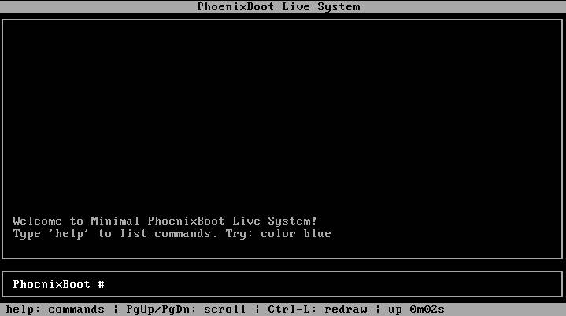

# PhoenixBoot



PhoenixBoot is a minimal, bootable Linux live-system project with a small custom C interface. It builds a kernel, packs the init program into an initramfs, and creates a bootable ISO.

**Networking and Wi‑Fi are not implemented yet.** The current image does not provide `nmcli` or network management. USB support is currently aimed at input devices; USB storage and general USB-device management are not yet documented as supported features.

## Current features

- Custom C init program with a text-based interface and built-in commands
- Linux kernel built from source
- Initramfs containing the init program
- GRUB-bootable ISO
- QEMU target for testing
- Console, keyboard, and graphics-related kernel configuration

## Requirements

The build uses Nix for toolchain dependencies and requires the tools used by the Makefile, including `gcc`, `make`, `cpio`, and `grub-mkrescue`. QEMU is needed to run the provided test target.

On an Arch Linux host, install Nix and enable flakes if needed. The flake provides a development shell:

```sh
nix develop
```

## Build

From the project root, run:

```sh
make iso
```

The first kernel build downloads the configured Linux source version and may take some time. On success, the bootable image is written to:

```text
phoenixboot.iso
```

The Makefile’s kernel target uses `nix-shell` to obtain its build dependencies. The `kernel` package in `flake.nix` is defined separately; the Makefile does not currently build the kernel through that flake package.

## Test with QEMU

```sh
make qemu
```

This starts QEMU with the generated ISO and 512 MiB of memory. To boot the ISO directly in QEMU instead:

```sh
qemu-system-x86_64 -cdrom phoenixboot.iso -m 512M
```

## Interface commands

The interface includes commands such as:

```text
help
clear
echo hello
uname
uptime
free
date
ls /
cat <file>
color <bg> [fg]
redraw
reboot
poweroff
```

The exact available commands are listed by entering `help` after boot.

## Project layout

```text
.
├── build-kernel.sh   # Kernel configuration and build script
├── flake.nix         # Nix development environment and kernel package
├── Makefile          # Initramfs, ISO, QEMU, and cleanup targets
├── init.c            # Init process and text UI
└── src/
    ├── ui.h          # UI and command declarations
    ├── commands.c        # Built-in commands
    ├── color.c           # Color command
    └── cave_exp.c        # Additional command
```

## Cleanup

Remove generated init, initramfs, ISO, and build directories:

```sh
make clean
```

Remove those files and the downloaded/built kernel as well:

```sh
make distclean
```

## Development status

PhoenixBoot is experimental. Networking, Wi‑Fi, `nmcli`, and general USB-device management are planned but are not included in the current image.

Works on Compaq 6530s, but not on Pavilion 15 eh-xxxx due to Kernel Panic.

`poweroff` doesn't work currently.

## TODO

Audio, Networking, USB, Mouse, Poweroff, UEFI, Secureboot, Resolution Adjustment
